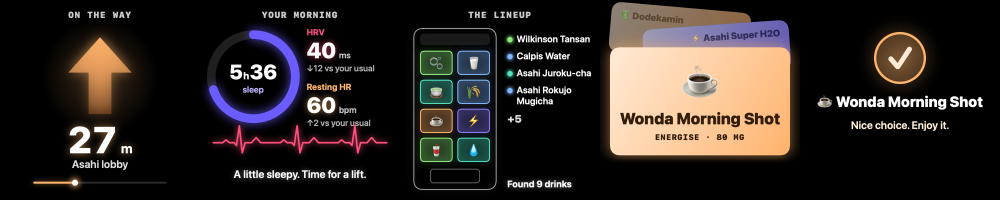
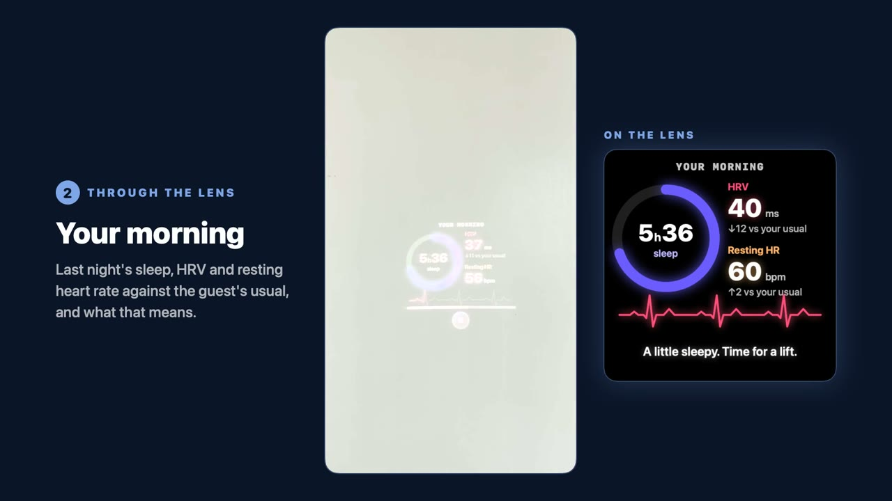

# EmoDrink Glasses

Three drinks, picked from how you slept, offered the moment you reach the
vending machine. On **Meta Ray-Ban Display** glasses, or an iPhone alone in
phone mode. In Japanese or English.

<p align="center">
  
</p>

<p align="center">
  
</p>
<p align="center"><em>What the guest sees on the lens during a showcase run: the walk to the machine, their morning, the machine's lineup, three drinks, the pick.</em></p>

<p align="center">
  <a href="https://youtu.be/Yzrz8hdsBdM"></a>
</p>
<p align="center"><em><a href="https://youtu.be/Yzrz8hdsBdM">Watch the 78-second demo on YouTube</a>: the showcase filmed through the lens and from the wearer's eyes, then live drink mode, narrated with the app's own Gemini voice. (Also in the repo: <a href="docs/media/emodrink-demo.mp4">emodrink-demo.mp4</a>.)</em></p>

EmoDrink Glasses continues the [EmoDrink](https://dl.acm.org/doi/full/10.1145/3795011.3797399)
work (Augmented Humans 2026, AHLab with Asahi as the study's industry
partner): a physiological signal is only useful at the moment a person can
act on it. The study did that in a Quest 3 with a room-anchored virtual
machine. This does it on glasses, in the real world, hands-free, in a few
seconds. Built as a thank-you for Taka, who ran the study and lent the
glasses.

It is a fork of [Hermes Glasses](https://github.com/prasanthsasikumar/hermes-glasses),
MIT licensed, cut down to EmoDrink alone. Everything else Hermes does lives
on in the Hermes Glasses repo.

## Two ways to use it

**The showcase** is what the app opens on, built for demos. Pick the vending
machine, the guest (a morning profile) and the language, press **Start**,
and the glasses walk the guest through it:

1. **On the way:** an arrow and the distance counting down to the machine
   (optional, per machine).
2. **Your morning:** last night's sleep, HRV and resting heart rate against
   the guest's usual, and one line on what that means.
3. **The lineup:** the machine's drinks, scanned.
4. **Three drinks:** picked for that morning from the machine's own drinks,
   with a spoken reason. The guest picks by tapping the lens, saying a number
   or saying a name, and can ask "why".

**Reset** clears it for the next guest. Add machines by voice ("add a
machine", then read out the drinks) or from the machine list.

**Live drink mode** is one row below on the same home, for the real world.
It watches the camera, and when it sees a vending machine or a few drinks it
**reads the labels**: the three choices come from the drinks actually in
view. Hold up a single drink ("shall I drink this?") and it tells you whether
that one suits you this morning, and what it would pick instead. Drinks it
does not know are named, never guessed at.

<p align="center">
  
  &nbsp;&nbsp;
  
</p>
<p align="center"><em>Live drink mode. Left: the Ray-Ban Display camera on the phone while the lens offers three drinks. Right: before Start.</em></p>

## What it does

- **Reads your morning.** Last night's sleep hours and score, HRV and
  resting heart rate against your usual, steps and stress, from a small JSON
  document at a URL you control (the repo's `mock/physiology.json` by
  default, a fixed sample, and the card says so). Three sample profiles for
  an offline demo.
- **Picks on the phone, not in the cloud.** A deterministic rule ranks 29
  public Asahi Group soft drinks against what your body needs this morning
  (energise, calm, hydrate, recover). The AI only phrases the line and
  answers questions; it never chooses.
- **Sees what is in front of you.** In live drink mode a frame goes to the
  vision model only when the scene changes and settles (at most 150 small
  calls an hour), and the model reads the drink names off the labels.
  "Check now" asks at once.
- **You pick by tap, number or name.** "Two", "the second one", 「二番目」,
  「二つ目」, "Wilkinson", 「麦茶」. The lens narrows to that drink with Why and
  Thanks, and a warm one-line reason is spoken.
- **Japanese both ways.** Speech recognition, lens text and spoken lines in
  Japanese or English; a Japanese run speaks only Japanese.
- **Sounds natural.** Spoken lines use Google's Gemini voice (Kore for
  Japanese, Aoede for English). Offline or on any error it falls back to the
  best on-device voice at once.
- **Talks about it.** Anything else you say goes to the drink persona, which
  knows your numbers and the catalogue and follows the study's rule:
  suggestive, never diagnostic.

## Say

| Say | What happens |
|---|---|
| "What should I drink" / 「何を飲めばいい」 | Three drinks, now |
| "Shall I drink this?" / 「これ飲んでいい？」 | A photo goes with the question |
| "Two", "the first one", a drink's name / 「二番目」「最初の」 | That drink, and why it fits |
| "Why" / 「なぜ」 | The reason, in the persona |
| "Back" / 「戻る」 | The three again |
| "Something else" / 「他には」 | The next three |
| "Thanks" / 「ありがとう」 | Ends the moment |
| "Start drink mode" / 「見守りを開始」, "Stop drink mode" / 「見守りを停止」 | Watching on / off |

## Try it

1. **Install** the TestFlight build (ask for an invite), or build it
   yourself (below).
2. **Glasses.** In the Meta AI app (v272 or later, glasses firmware v125 or
   later), open Settings › App Info and tap App Version five times for
   Developer Mode, then press **Install** for the Device Access Toolkit
   (accept the Wi-Fi prompt). Pair from EmoDrink (Settings › Glasses), allow
   the glasses camera when Meta AI asks, and allow local network access when
   iOS asks. No glasses? Phone mode uses the iPhone camera.
3. **Permissions.** Microphone and speech recognition (to pick by voice),
   camera (to see the machine), Bluetooth and local network (to reach the
   glasses), location and motion (context for the assistant).
4. **Check the basics** if anything looks wrong: Settings › Glasses ›
   Developer › Glasses basics sends text to the lens, shows the glasses
   camera on the phone, and runs a vision check with the answer on the lens.
   If one of these fails, nothing else will work.
5. **Before a demo,** open the showcase home with the machine, guest and
   language selected a minute early, so the lens clips are rendered and
   cached. More in [docs/RELEASE.md](docs/RELEASE.md).

Tips: use the iPhone mic (or headset mode with earbuds) during a run, since
the glasses' own mic brings up their call screen over the lens. For a better
on-device voice, install Kyoko (Enhanced) and an Enhanced English voice in
iOS Settings › Accessibility › Spoken Content › Voices.

## Your own data

Point the feed URL (Settings › Drinks) at a JSON document of this shape,
for example one a watch sync writes:

```json
{
  "date": "2026-10-07",
  "source": "Garmin Venu 3S",
  "sleep": { "hours": 6.2, "score": 61 },
  "hrv_ms": 38,
  "hrv_baseline_ms": 52,
  "resting_hr": 58,
  "resting_hr_baseline": 54,
  "steps": 4200,
  "stress": 46
}
```

`stress`, `steps` and the baselines are optional; unknown keys are ignored.
The app keeps the last fetch and fetches again when that copy is older than
30 minutes, or when you tap "Fetch again". The three sample profiles under
"Use sample data" work offline.

## Build it

```bash
cp Config/Secrets.example.xcconfig Config/Secrets.xcconfig   # then fill it in
xcodebuild -project HermesGlasses.xcodeproj -scheme HermesGlasses \
  -destination 'generic/platform=iOS' build
```

`Config/Secrets.xcconfig` is gitignored and holds:

- `META_APP_ID` / `CLIENT_TOKEN`: the app's entry in the Meta Wearables
  Developer Center, tied to the bundle id `com.flowsxr.emodrink`. The
  glasses link only to a bundle id registered there. Phone mode works
  without it.
- `BUNDLED_AI_PROVIDER` / `BUNDLED_AI_MODEL` / `BUNDLED_AI_KEY`: the
  built-in assistant (Gemini `gemini-3.5-flash-lite`, direct), so nobody has
  to type a key. A key you add in Settings › Assistant always wins.
- `BUNDLED_TTS_KEY` / `BUNDLED_TTS_MODEL`: the Gemini voice. Without them
  the app speaks with the on-device voice.

Releasing to TestFlight (`tools/release.sh <build>`) and getting the app onto
someone else's glasses are covered in [docs/RELEASE.md](docs/RELEASE.md).

## How it works

The phone does everything; there is no server:

```
┌─────────────┐   Bluetooth    ┌──────────────┐     HTTPS      ┌─────────────────────┐
│  Ray-Ban    │ ─────────────▶ │  iPhone app  │ ─────────────▶ │  Gemini             │
│  Display    │  (DAT SDK:     │  (SwiftUI)   │  one photo,    │  (or your own       │
│  glasses    │   camera, lens)│  on-device   │  the phrasing  │  Claude, OpenAI,    │
└─────────────┘ ◀───────────── │  STT + pick  │ ◀───────────── │  OpenRouter key)    │
                 cards + clips └──────────────┘   reply text   └─────────────────────┘
```

- **iOS app** (`HermesGlasses/`): SwiftUI and the
  [Meta Wearables Device Access Toolkit](https://github.com/facebook/meta-wearables-dat-ios)
  for registration, sessions, camera and the lens, all through one
  `GlassesLink` service lifted from Meta's DisplayAccess and CameraAccess
  samples; `SFSpeechRecognizer` for on-device speech; the Gemini voice with
  `AVSpeechSynthesizer` as the offline fallback.
- **The lens** gets rendered 600 x 600 cards for anything in colour (the
  lens's own text has two colours) and short pre-rendered clips for the
  showcase's animations, served to the SDK from the phone over local HTTP.
- **Pure, tested logic.** The picker, the showcase autopilot, the label
  reader, the voice-command parsers and the display decisions are plain
  Swift with no UI, each with a standalone suite under `tests/` (the
  `xcrun swiftc` line is in each `main.swift` header).

```
HermesGlasses/
├── Services/
│   ├── GlassesLink.swift              # the one DAT path: session, display, camera
│   ├── HermesDisplayManager.swift     # lens cards and clips, one serialized queue
│   ├── HermesSpeechRecognizer.swift   # on-device live STT
│   ├── HermesSpeechSynthesizer.swift  # Gemini voice, on-device fallback
│   ├── DirectClient.swift             # provider calls and conversation memory
│   ├── Providers/                     # Gemini, Claude, OpenAI-compatible
│   ├── EmoDrink/                      # feed, picker, persona, label reader, gate
│   └── Showcase/                      # the autopilot, machines, guests, clips
├── Resources/EmoDrink/asahi-drinks.json   # the drink catalogue
├── ViewModels/                        # session, live drink mode, showcase
└── Views/                             # showcase home, live drink mode, Settings
mock/physiology.json                   # default feed (a fixed sample document)
tests/                                 # standalone swiftc suites, one dir per unit
tools/                                 # release.sh, pbx-register.py, pbx-unregister.py
```

Design notes: `docs/superpowers/specs/` (the EmoDrink and focus specs).

## Known limitations

- **The glasses draw a playback bar under every clip.** It is the
  firmware's video chrome and the SDK has no way to hide it.
- **Mic or lens, not both, with the glasses' own mic.** It is Bluetooth
  HFP, and an active HFP link shows the call screen over the lens. The
  iPhone mic, or headset mode with earbuds, keeps the lens.
- **Developer Mode on the glasses** is needed until the Meta integration is
  published to a release channel (see [docs/RELEASE.md](docs/RELEASE.md)).
- **The built-in key ships in the app.** Fine for a TestFlight gift with a
  spending limit; a public release would put it behind a proxy.
- **Label reading** has had a handful of real-world tries; small or
  turned-away labels are left out rather than guessed.

## License

MIT, see [LICENSE](LICENSE). Drink names and the Asahi brand belong to their
owners; the catalogue lists public products for the demo only.
